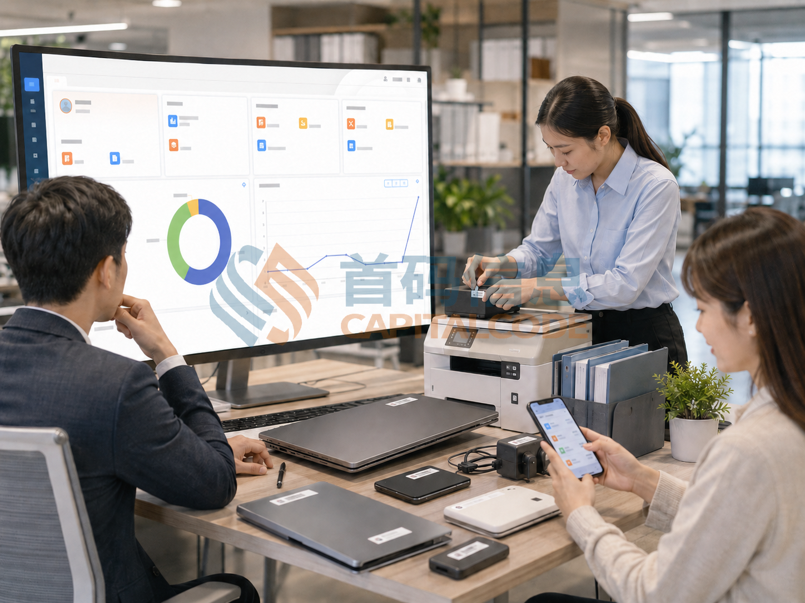
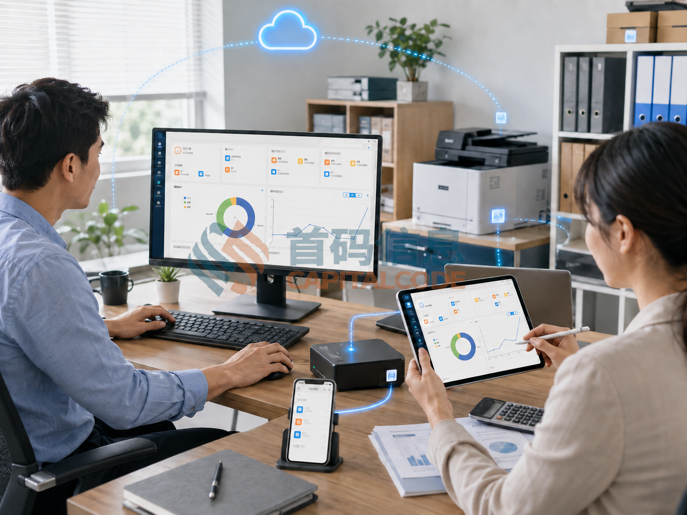

# 员工离职转岗时 固定资产怎样交接才不留尾账

员工把笔记本放回行政办公室，接收人员在离职单上签了字，几周后盘点时，显示器仍登记在原员工名下，扩展坞也找不到去向。另一种情况是员工转岗后继续使用原设备，新旧部门都以为对方会更新台账，结果设备有人用，责任记录却停在原处。

固定资产交接需要落实到每件实物。发起时确定范围，接收时核对身份和状态，结束时明确新的保管关系；暂时无法完成的项目，则单独留下处理人和期限。这样才能避免一张整单签字掩盖多个未完成事项。

## 从领用记录中整理待交接清单

收到离职或转岗通知后，资产管理员可以按人员标识汇总其名下的领用、借用和代管记录。仅按姓名搜索容易把同名人员混在一起，也可能漏掉借用单中尚未归还的设备。

清单应包含资产编号、名称、型号、所在位置、当前状态及随附物品。笔记本、显示器若分别建档，应分别列项；未独立建档的电源适配器、支架和扩展配件，可以列在对应设备的附件栏，避免接收时只核对主机。

员工需要核对这份清单，并补充台账没有记录的实际情况。例如，设备在异地项目现场、临时交给同事使用，或已经送修。借给同事不等于责任已经转移，送修也不等于可以从清单中删除，相关情况应附上可追查的记录。

会议室和实验室中的共享设备，则要核实离岗人员是实际使用人、代管人还是登记联系人。若只需变更保管责任，可以在原地点交接，避免为了完成流程而搬动仍在使用的设备。

## 离职归还与转岗续用分别处理

离职场景需要确认设备交回库房、转交指定人员，还是仍有事项待处理。转岗场景则应先判断原设备能否随人继续使用，再按内部制度办理部门、位置或保管关系变更。

例如，员工调入另一部门后仍使用原笔记本，实物没有进入库房，就不宜为了走完流程虚填一次“归还入库”。可以记录原部门释放、新部门接收及生效日期，并保留设备当前位置。成本归属等信息是否调整，由对应管理人员按既有规则确认。

对于寄回的设备，寄出、物流签收和验收完成也应分开记录。快递送达只能证明包裹已到达，无法说明编号、附件和设备状态已经核对。接收人员完成检查后，再确认相应交接项目。

## 验收要同时核对实物和记录

现场交接时，双方先确认资产编号及其他可核验标识，再检查外观、基本状态和附件。型号相同的两台设备，不能只凭外观认定是哪一台；标签缺损时，可以结合序列号、原始登记信息等线索复核，查明身份后再处理补标。

RFID识读可以辅助匹配标签与资产记录，但读到标签不等于设备功能正常，也不等于附件齐全。为避免邻近设备被误纳入交接，应限定本次清单，并对实际接收的实物逐件确认。

验收结果可以分为接收完成、已接收待检测、附件待补和实物待核实等情况。资产已经由库房保管，但功能检测尚未完成时，应如实记录接收人和接收时间，同时保留待检状态，避免因为检测未完成而让保管责任继续悬空。

## 设备归还后还有哪些事项需要确认

计算设备归还后，业务资料移交、访问权限调整、数据处理及重新部署，应交由相应人员按照组织制度完成。资产管理员可以在交接记录中关联办理结果，不必把业务文件内容复制到资产台账。

设备接收与这些事项各有完成条件。可以先记录实物已经入库，设备仍处于待处理状态；只有满足再次领用条件后，才进入可发放清单。原使用人的设备照片或口头说明，也不能代替实际处理结果。

一份便于复查的交接记录，可以保留以下内容。

- 交接对象与范围，包括本次涉及的资产及附件。
- 实物核对结果，包括已发现的问题和相关记录。
- 当前保管人及存放位置，包括接收时间。
- 尚未完成的事项，包括处理人、下一步和约定期限。
- 每项确认的办理人及时间，便于追查状态变化。

使用首码 RFID 资产管理系统办理交接时，可将人员清单、逐项接收、附件记录和历史查询列入流程配置及验收范围，并按实际版本核实支持情况。交接单上的状态应与现场动作对应，减少管理员事后凭聊天记录补录的工作。

## 有差异的资产单独跟进

假设一份交接清单包含四件资产，其中两件已接收，一件正在外部维修，一件需要核实去向。可以分别记录两件的接收结果，为维修设备关联维修单，并为去向待核的设备指定跟进人。不能为了让整单显示完成，把四件全部改成已归还。

对实物待核的项目，先查领用、借用、维修及转交记录，再联系有关人员核实。尚未查明去向时，保留“待核实”状态和已完成的排查动作，避免过早把记录写成遗失结论。

人员离岗后，未完成事项仍要能被后续负责人查到。原人员档案可以停用，但与资产交接有关的历史记录应按组织的留存规则保留，不能因为账号停用就一并消失。

## 结束交接前查一次接收结果

交接结束前，资产管理员可以从接收方视角复核：库房是否能查到新接收设备，新保管人名下是否出现对应记录，继续使用的设备是否已更新部门和位置。仅检查原领用人名下是否清空，容易漏掉设备被转到错误人员或错误地点的情况。

后续按月查看待验收、附件待补和去向待核的存量，关注各自停留时间。问题集中在寄回设备，就调整签收后的验收安排；问题集中在转岗续用，就补齐部门间的确认节点。

一项资产交接能否结束，应该能够从记录中直接看出：实物由谁保管，状态由谁确认，遗留事项由谁继续处理。把这些信息落实到每一件设备，人员变动后才有连续、可查的资产记录。
