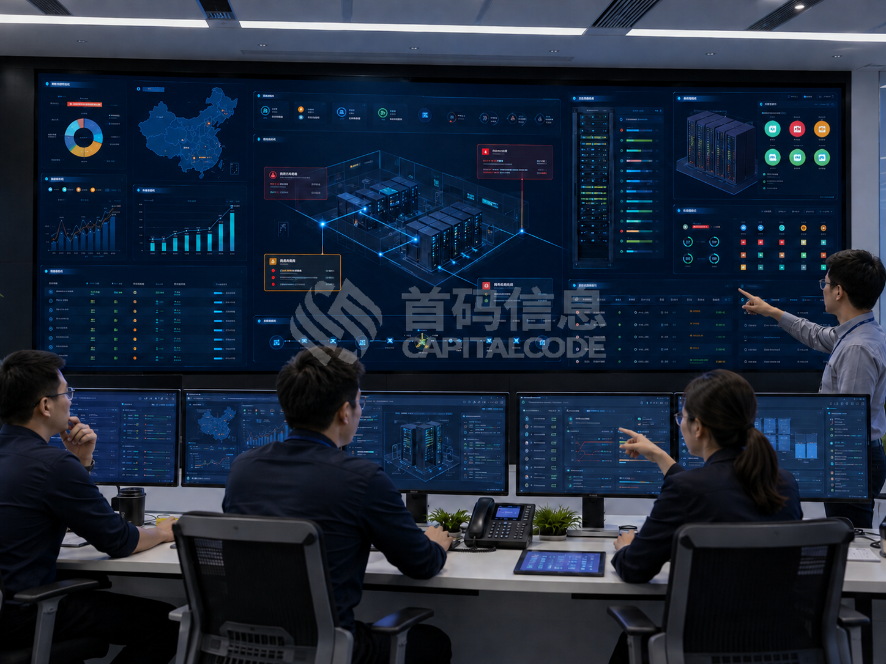
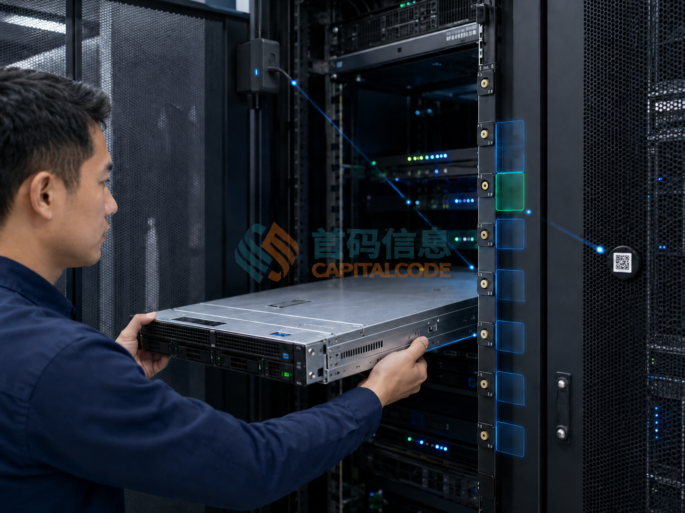

# U位资产告警频繁 怎样区分设备移动与采集异常

值班人员收到设备离位提醒，打开机柜图时，又发现同一机柜有多台设备状态异常。几分钟后画面恢复，现场却没有对应的搬运记录。这类情况如果每次都直接点击确认，后续就难以分辨哪些设备确实动过，哪些只是数据暂时没有更新。

U位资产告警需要同时核实实物与采集链路。设备所在位置、数据更新时间、采集端状态以及相关变更记录，应放在一起判断。告警消失只是画面状态发生了变化，原因是否查明、台账是否需要调整，还需要留下处理结论。

## 将设备状态与采集状态分开查看

设备移出原位置、标签关联出现问题、采集端通信中断，可能在界面上都表现为某条资产记录异常，后续处理却不同。值班人员需要知道告警由哪类事件触发，涉及一个位置、一台设备，还是一整段采集范围。

在系统设计和验收中，可以分别设置实物位置状态与数据有效性状态。某设备此前登记在A01机柜的第12至13U，采集端随后离线，管理端可以保留此前的位置记录，并明确标出数据待更新。此时不宜直接把这段位置改成可分配空位。

告警名称也应与证据对应。尚未确认实物去向时，“位置待核实”有助于提示下一步动作；直接显示“设备丢失”，可能让未验证的判断进入后续报表。

## 同时核对事件时间与接收时间

处理告警时，可以依次查看设备此前被有效采集的时间、事件记录时间、平台接收时间和通知到达时间。这几个时间可能不同，尤其是在通信恢复后补传记录的场景中。

假设一条14时发生的事件在14时08分才被平台接收，通知时间不能直接当作设备刚刚发生变化的时间。这个例子只用于说明记录顺序；现场需要结合系统是否支持缓存、补传及事件时间记录进行判断。

跨系统核对时，还应检查时间同步、时区和字段含义。工单中的计划开始时间、现场操作时间及平台日志时间，各有用途，不能只因显示相近就认为已经相互印证。

如果当前版本只提供接收时间，就在处置记录中保留这一限制，并依靠现场记录补充核实。不要通过修改时间或补填推测值，让事件看起来符合预期顺序。

## 根据异常范围安排排查顺序

单台设备的位置记录发生变化，而同机柜其他设备持续正常更新时，可以优先核对该设备的变更工单、标签安装状态及现场位置。工单内容要具体到资产标识、原位置、目标位置和操作窗口，不能只看当天是否有一张维修单。

若同一采集端覆盖的多台设备同时停止更新，则应并行检查采集端状态、通信日志和相关供电情况，并按现场制度安排实物核查。多设备同时异常是排查线索，不能据此排除真实移动，也不能直接认定已经发生批量离位。

若异常出现在模块更换、机柜编号调整或标签重新绑定之后，还要核对配置对应关系。显示在A01上的数据是否实际来自A02，位置编号方向是否一致，都可能影响后续判断。

## 告警关联工单后仍需确认实际操作

有已批准的变更工单，不代表工单范围内的每个动作都已经正确完成。现场仍需核对设备身份、实际位置和实施时间。计划移动的对象与告警对象不一致时，应作为差异继续处理。

对于安排在维护窗口内的操作，可以按照组织制度配置通知策略，但应保留原始事件和工单关联。窗口之外、超出批准对象或涉及不同位置的变化，需要继续按相应规则提示，避免一张工单让整片区域的异常都失去关注。

现场核实后，处置记录可以分为已批准移动、待查明移动、采集通信异常、标签安装问题或配置对应问题。每个结论都要关联相应依据，并注明是否需要更新资产位置。

在首码磁控U位管理系统的部署与运维中，可将上述事件分类、数据更新时间、工单关联和处理历史作为配置及验收清单，逐项核实现场方案与版本支持情况。位置变化信息能够支持核查，操作人和授权依据仍需要通过工单及相关记录确认。

## 通信恢复后再做一次位置复核

采集端重新上线，只能说明某个通信条件已经恢复。要确认资产记录可继续用于管理，还需要检查设备与机柜的对应关系、相关位置的采集结果，以及是否仍有待处理事件。

支持缓存补传的系统，还应验证历史记录是否被重复处理，迟到事件是否会覆盖较新的有效状态。具体处理规则应在部署测试时确认，并通过日志检查实际结果，不能默认通信恢复后所有数据都已自动整理完成。

现场若进行了标签调整或模块更换，应保存调整前后的关联信息，再观察位置状态是否稳定。对于尚未完成核查的区间，继续标记待核实，避免因为界面暂时恢复正常就被安排新的设备上架。

## 复盘时关注哪些告警反复出现

可以按事件类型统计发生数量、重复出现的机柜、待处理时长和复核结果。若通信异常集中在同一采集端，后续工作应围绕这段链路展开；若现场移动经常找不到对应工单，则需要检查变更登记和现场执行之间的衔接。

告警确认和处理完成也应分开统计。有人接单只能说明已经开始响应，原因查明、状态复核及台账更新完成，才说明该事件具备结束条件。同一故障产生多条通知时，可以关联处理，但保留各条原始记录，避免直接删掉重复提示。

值班交接时，与其只留下“某机柜告警已恢复”，不如写清异常范围、已核实的事实、采取的动作，以及还有哪些设备需要复查。下一班人员能够从这份记录继续处理，告警才真正进入了日常运维流程。
